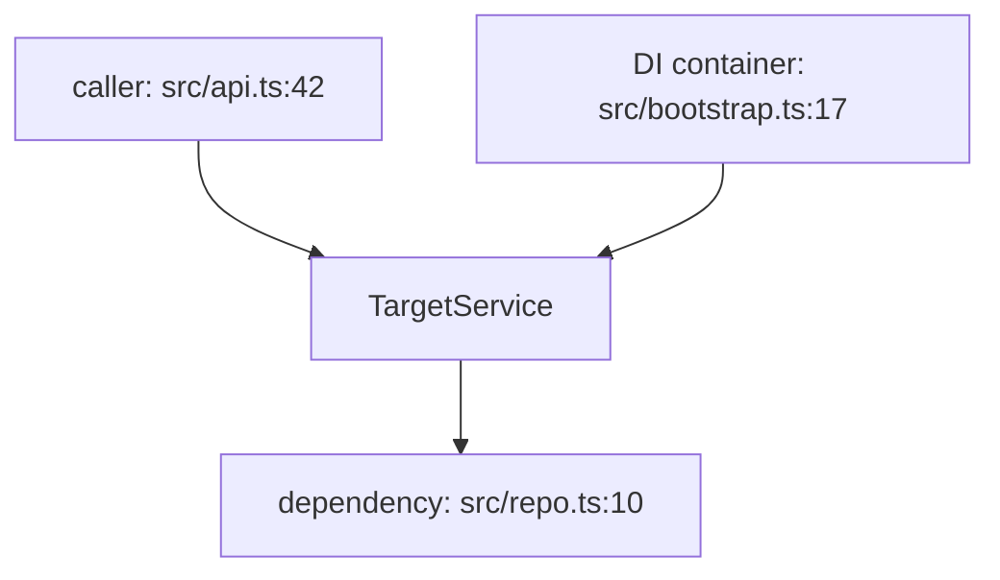

Trace: $ARGUMENTS

Analyze how the given service, module, function, or file fits into the codebase —
where it is defined, where and how it is used, and what depends on it. This is an
analysis-only task: do NOT modify any files.

## 1. Locate the target

- If $ARGUMENTS is a path, read it and identify its primary exports/declarations.
- If it is a symbol (class, function, interface, type), find its definition first:
  search for the declaration pattern (`class X`, `function X`, `export const X`,
  `def X`, `func (…) X`, etc.) and note the definitive file:line.
- If it is a concept (e.g. "authentication", "the billing flow"), map it to the
  concrete modules/files that implement it before tracing.

## 2. Disambiguate

- If the symbol is overloaded, shadowed, or appears in multiple packages, state
  which variant you traced and why (check imports at the call sites).
- If there are multiple definitions, note the canonical one and list the others.

## 3. Find callers (who uses it)

- Search for every reference: imports/requires, direct calls, property access,
  instantiation, type references, string references (e.g. route/DI names).
- For each usage site, record: file:line, what kind of usage it is (call,
  injection, config, event subscription, reflection), and the enclosing function/class.
- Check wiring patterns specific to the stack:
  - DI/containers: constructor params, `@Inject`, `provide()`, service registries,
    module imports, `new X()` factories.
  - Frameworks: route registrations, controllers, middleware, event listeners,
    cron jobs, CLI commands, hooks.
- Follow the chain one level up where useful: who calls the caller?

## 4. Find callees (what it depends on)

- List what the target imports/calls/reads: internal modules, external libraries,
  database queries, HTTP/API calls, environment variables, config files.
- Note which are essential to its contract vs. incidental.

## 5. Describe lifecycle & usage patterns

- How is it instantiated: singleton, per-request, lazy, factory-created?
- Where is it configured (config files, env vars, constructor args) and what are
  its defaults?
- When is it invoked: startup, on demand, background/async?
- Are there multiple consumers with different roles (primary path vs. edge case)?
- Flag anything notable: dead code (defined but never referenced), hot paths,
  circular dependencies, duplicated usage patterns.

## 6. Check related tests

- Find tests that exercise the target (unit, integration, e2e) and note what
  behavior they cover — or note their absence.

## Output

1. **Summary** — one paragraph: what it is and its role in the system.
2. **Definition** — canonical location (file:line) and what it declares.
3. **Callers** — table: file:line, usage kind, enclosing context, one-line purpose.
4. **Callees / dependencies** — table: dependency, type (internal/external/DB/env), purpose.
5. **Lifecycle & patterns** — bulleted: instantiation, configuration, invocation timing, notable findings.
6. **Tests** — which tests cover it (or "none found").
7. **Mermaid flow diagram** — callers → target → callees, verified against the code:

Keep the diagram under ~15 nodes, focus on the most important paths, and use real
file:line labels on every node. If the diagram would exceed ~15 nodes, show the
core flow in mermaid and list the rest in the callers/dependencies tables.

## Rules

- Every claim must cite a real file:line — never infer without checking.
- If the target is a concept rather than a single symbol, structure the answer
  around the modules that implement it and say so explicitly.
- If the trace is large, prioritize the most important paths and note what was
  omitted.
